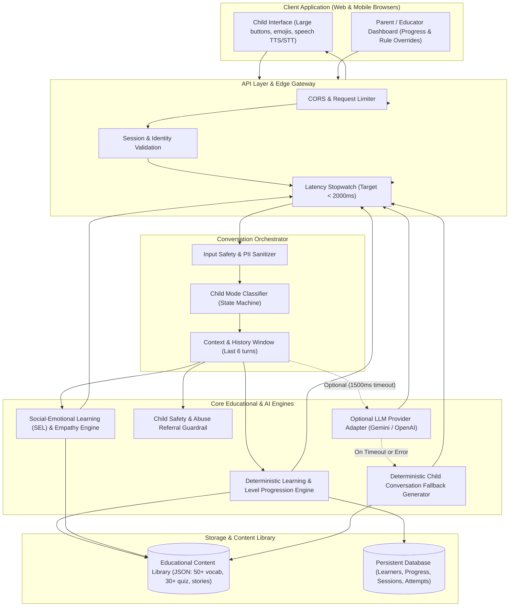

# System Architecture: AI-Powered English Learning Chatbot

## 1. Architectural Overview

The application follows a **hybrid, low-latency, child-centered architecture** combining deterministic educational rule engines with optional Large Language Model (LLM) augmentation. This guarantees sub-2-second response latency, 100% availability, and strict safety guardrails for young children under seven.

## 2. Key Architectural Decisions

1. **Hybrid LLM + Deterministic Core**:
   - High-stakes educational progression, quiz scoring, hint delivery, and safety enforcement are completely deterministic.
   - LLM is used only for natural conversational expansion when keys are provided and completes within a strict 1,500ms deadline.
   - If the LLM provider fails, times out, or is omitted, the deterministic fallback delivers high-quality child responses with 0ms downtime and ~10-25ms latency.

2. **Multi-Signal Child Mode Classifier**:
   - Distinguishes between `LEARNING`, `CONVERSATION`, `ENGAGEMENT`, `SUPPORT`, and `IDLE`.
   - Never traps a child in an unwanted lesson; respects explicit "stop" and "exit" commands.
   - Identifies repeated failure and lowers question difficulty while injecting emotional support.

3. **COPPA / Child Safety by Design**:
   - Zero real-world identity collected (no full names, phone numbers, emails, or geolocations).
   - Audio is synthesized and recognized purely in-browser using Web Speech APIs; zero voice audio recordings are captured or stored on servers.
   - Immediate trusted-adult referral if abuse or danger is detected.
