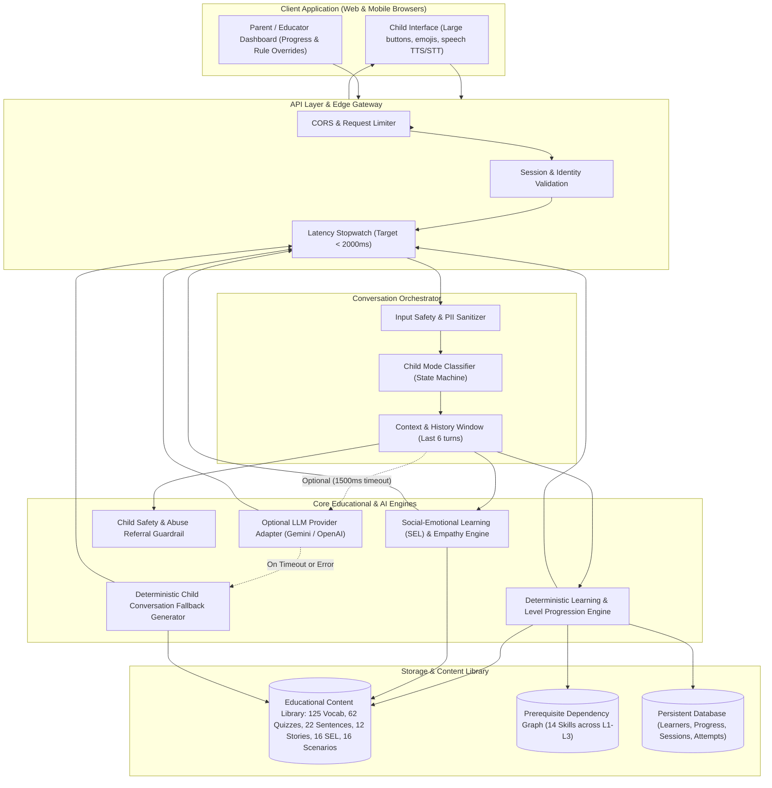

# System Architecture: AI-Powered English Learning Chatbot

## 1. Architectural Overview

The application follows a **hybrid, low-latency, child-centered architecture** combining deterministic educational rule engines with optional Large Language Model (LLM) augmentation. This guarantees sub-2-second response latency, 100% availability, and strict safety guardrails for young children under seven.

## 2. Key Architectural Decisions

1. **Hybrid LLM + Deterministic Educational Core**:
   - High-stakes educational progression, quiz scoring, hint delivery, prerequisite checking, and safety enforcement are completely deterministic.
   - LLM is used only for natural conversational flexibility within strict child-friendly token and length limits.
   - Strict 1,500ms provider timeout with instant deterministic fallback guarantees zero downtime and sub-50ms p95 latency.

2. **Skill-Level Prerequisite Dependency Graph**:
   - 14 versioned skills mapped across Levels 1 through 3.
   - The adaptive engine verifies that prerequisite skills are mastered (e.g. `everyday_objects` and `animals_basic` before Level 2 `actions`) before offering advanced practice.

3. **Exponential Moving Average (EMA) Mastery Model**:
   - Real-time score: `newMastery = 0.35 * latestEvidence + 0.65 * previousMastery`.
   - Requires at least 3 attempts to establish mastery (threshold ≥0.80), insulating early learners from single-guess luck or temporary fatigue.
   - Hint usage applies a transparent evidence penalty (`latestEvidence = 1.0 - 0.25 = 0.75`), encouraging independence while preserving positive reinforcement.

4. **Multi-Signal Child Mode Classifier**:
   - Distinguishes between `LEARNING`, `CONVERSATION`, `ENGAGEMENT`, `SUPPORT`, and `IDLE`.
   - Respects explicit "stop", "exit", or "break" commands immediately by switching out of quiz mode.
   - Triggers empathetic support on signs of distress or consecutive errors without medical labeling.

5. **COPPA / GDPR-K Child Safety by Design**:
   - Zero child PII collected (pseudonymous avatars and star counts only).
   - Audio synthesized and transcribed locally via client-side Web Speech API (no server-side audio storage).
   - Immediate trusted-adult referral if harm, distress, or abuse is disclosed.
   - Explicit parent-facing GDPR-K data deletion route (`DELETE /api/v1/learners/:id/data`).

