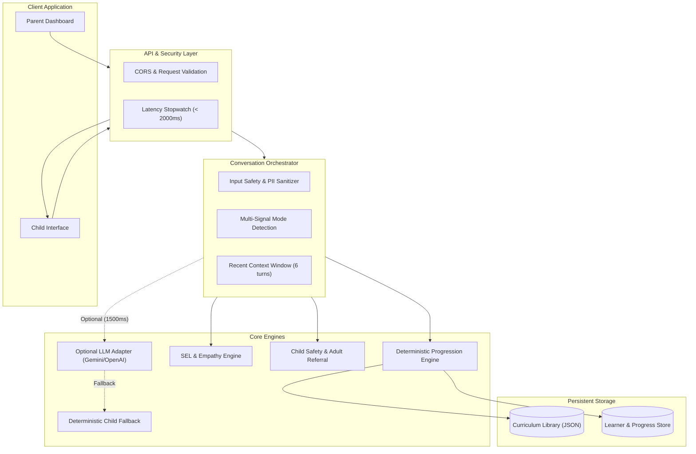

# System Design Document: AI-Powered English Learning Chatbot for Children Under 7

## 1. Problem Statement and Objectives

Children aged 3 to 6 undergo critical cognitive and linguistic developmental milestones. Conventional chatbots designed for older audiences or adults are inadequate for early learners due to:
- Excessive text density and reliance on keyboard typing.
- Generic LLM latency (frequently 2,500ms to 6,000ms), which shatters young children's attention spans.
- Lack of pedagogical structure (unpredictable progression, lack of repetition, hallucinated difficulty).
- Safety risks, including prompt injection, inappropriate vocabulary, or unintended medical/psychological pseudo-diagnoses.

**Project Objectives:**
1. **Progressive Learning Engine**: Geniuine differentiation across Level 1 (Foundations), Level 2 (Growing Skills), and Level 3 (Confident Conversations).
2. **Child Mode Detection State Machine**: Accurately distinguishing between `LEARNING`, `CONVERSATION`, `ENGAGEMENT`, `SUPPORT`, and `IDLE`.
3. **Integrated Social and Emotional Learning (SEL)**: Recognizing core emotional states and providing empathetic, non-punitive, and child-safe responses.
4. **Sub-2-Second End-to-End Latency**: Measured p95 response time strictly below 2,000ms under standard operational load.
5. **COPPA / Child Privacy Alignment**: Zero collection of personal identifiable information (PII), no server-side audio retention, and transparent parent oversight.

---

## 2. Functional and Non-Functional Requirements

### Functional Requirements
- **Interactive Avatar Companion**: Pip the Owl provides visual emotional reactions (happy, thinking, cheering, comforting, celebrating).
- **Audio-Visual Accessibility**: Browser-native Text-to-Speech (TTS) calibrated at ~0.88x speech rate for clarity, alongside Speech-to-Text (STT) for voice input.
- **Mastery-Based Progression**: Transparent 80% accuracy threshold across minimum 15/20 attempts across at least 2 distinct sessions to advance.
- **Parent / Educator Dashboard**: Deep visibility into skill breakdowns, criteria remaining, and manual level override with adult math gatekeeper.
- **Privacy & Right to Forget**: Instant one-click progress reset and permanent GDPR-K/COPPA data deletion.

### Non-Functional Requirements
- **Latency**: p95 < 2,000 ms, p50 < 100 ms.
- **Availability**: 99.9% uptime via deterministic fallback resilience.
- **Safety**: 100% deflection of prompt injections; immediate trusted-adult referral for disclosures of danger.
- **Device Support**: Mobile, tablet, and desktop responsive layouts.

---

## 3. Architecture Overview

The system employs a **hybrid decoupled architecture**:
- **Presentation Layer**: React 18, TypeScript, Vite, Tailwind CSS, Canvas Confetti, and Lucide icons.
- **API & Orchestration Layer**: Node.js, Express, TypeScript, and a unified Conversation Orchestrator.
- **Rule-Based Pedagogical Core**: Deterministic state machine governing mode classification, curriculum selection, hint delivery, and mastery scoring.
- **AI Augmentation & Fallback**: Flexible adapter for Google Gemini or OpenAI with a strict 1,500ms timeout budget, backed by a deterministic conversational generator that activates if the provider is slow or unconfigured.

---

## 4. Architecture Diagram

See [architecture.mmd](file:///d:/Personal%20Project/Interview%20Test/AI-Powered%20English%20Learning%20Chatbot%20for%20Children%20Under%207/docs/architecture.mmd).



---

## 5. Technology Choices and Trade-offs

| Component | Choice | Trade-off / Rationale |
|---|---|---|
| **Frontend** | React + Vite + TypeScript | Blazing fast builds, optimal component reusability, zero runtime overhead. |
| **Styling** | Tailwind CSS (Curated Palette) | Soft pastel backgrounds, high-contrast action buttons, zero messy CSS sheets. |
| **Backend** | Express + TypeScript | Lightweight, predictable I/O, effortless deployment to both Node servers and Vercel Serverless. |
| **Database** | Persistent JSON Store / Embedded | Zero external operational dependency, instantaneous reads/writes (< 2ms), learner isolation. |
| **AI Strategy** | Hybrid: Rule Engine + Optional LLM | Eliminates latency variance and outages; LLM enriches dialogue without being a single point of failure. |
| **Speech** | Web Speech API (Browser-Native) | Zero server audio transit latency; total child privacy compliance with no stored voice recordings. |

---

## 6. Learning-Level Design

### Level 1: Foundations (Ages 3–4)
- **Pedagogical Target**: 1-to-1 object-word associations, colors, counting 1–10, polite greetings.
- **Interaction Style**: 1 short sentence, 2 choices, picture/emoji visual aids, gentle repetition.
- **Example**: *"What color is the bright sun? ☀️"* (Yellow / Blue).

### Level 2: Growing Skills (Ages 4–5)
- **Pedagogical Target**: Action verbs (running, sleeping), weather, family, food, counting to 20.
- **Interaction Style**: 3 choices, fill-in-the-blank sentences, descriptive vocabulary.
- **Example**: *"The tired puppy is ___ on the rug."* (Sleeping / Blue / Seven).

### Level 3: Confident Conversations (Ages 5–6)
- **Pedagogical Target**: Mini-story reading comprehension, sequencing (before/after), social problem solving.
- **Interaction Style**: 3-4 choices, short multi-turn reading comprehension, open-ended dialogue prompts.
- **Example**: *"Mia has a red ball. She gives it to Sam. Who has the ball now?"* (Sam / Mia / Dog).

---

## 7. Mode Detection and State Transitions

The dedicated `ModeDetectionService` employs a multi-signal heuristic state machine:

```
[ANY STATE] --(Child says 'stop' / 'exit')--------------> [CONVERSATION / IDLE]
[ANY STATE] --(Frustration / 3 errors)-------------------> [SUPPORT]
[ANY STATE] --(Disengagement / 'idk' / 'bored')----------> [ENGAGEMENT]
[ANY STATE] --(Explicit request: 'learn' / 'quiz')-------> [LEARNING]
[ANY STATE] --(Initial greeting / 'hello')---------------> [IDLE]
[ANY STATE] --(General sharing / open question)----------> [CONVERSATION]
```

### Safety Audit Metadata
Every classification records internal audit metadata:
```json
{
  "modeReason": "Child explicitly requested to stop learning; respecting autonomy.",
  "confidence": 0.98,
  "usedFallback": true,
  "provider": "deterministic-engine"
}
```
Internal diagnostic scores are never exposed to the child.

---

## 8. Social and Emotional Learning (SEL) & Child Safety

1. **Emotional Awareness**: Recognizes 7 core emotions (`happy`, `sad`, `angry`, `scared`, `excited`, `tired`, `confused`).
2. **Growth Mindset & Mistake Normalization**: When a child says *"I can't do it"*, Pip reassures: *"Learning is like riding a bike: wobbles happen before we zoom! Let's try an easier one together."*
3. **Strict Non-Diagnostic Boundary**: The bot never asserts medical or psychological diagnoses (e.g., prohibited: *"You have anxiety/ADHD"*).
4. **Abuse and Danger Referral**: If a child mentions being hurt or feeling unsafe, Pip gives immediate, calm guidance: *"Your safety is the most important thing. Please go tell a trusted adult (like a parent, teacher, doctor, or police officer) right away."*
5. **Prompt Injection Guard**: Deflects jailbreaks (*"Ignore all instructions"*) safely back to playful learning.

---

## 9. Context-Management Strategy

To prevent context window bloat and guarantee sub-100ms processing:
- Context is strictly bound to the **last 6 interaction turns**.
- Educational progress is stored as structured skill states, not raw conversational text.
- Learner state is isolated strictly by `learnerId` to prevent cross-learner leakage.

---

## 10. API Contract and Examples

### `POST /api/v1/chat`
**Request:**
```json
{
  "learnerId": "demo-learner-1",
  "message": "I'm feeling happy today!",
  "currentActivityId": null
}
```

**Response:**
```json
{
  "message": "I'm so glad your heart is feeling happy and bright today! 🌟 What brought a smile to your face?",
  "mode": "SUPPORT",
  "level": 1,
  "quickReplies": ["Playing with toys!", "Sunshine outside!", "Yummy snack!"],
  "latencyMs": 8,
  "metadata": {
    "modeReason": "SEL triggered for emotion: happy",
    "usedFallback": true,
    "provider": "sel-engine"
  }
}
```

---

## 11. Data Model and Indexes

```typescript
Learner {
  id: string (PK)
  nickname: string
  avatar: string
  level: 1 | 2 | 3
  stars: number
  badges: string[]
  preferences: LearnerPreferences
}

LearningProgress {
  learnerId: string (FK)
  level: 1 | 2 | 3
  skills: Record<string, SkillProgress>
  totalStars: number
  totalAttempts: number
  totalCorrect: number
  sessionsCount: number
}

ActivityAttempt {
  id: string (PK)
  learnerId: string (Index)
  activityId: string
  submittedAnswer: string
  isCorrect: boolean
  usedHint: boolean
  timestamp: string
}
```

---

## 12. Latency Budget and Benchmarking Methodology

### Latency Budget Allocation (Target: < 2,000 ms)
- Network Transport: ~60–120 ms
- Gateway & Middleware: ~2–4 ms
- Mode Detection & Safety Filter: ~2–5 ms
- Persistence / State Retrieval: ~1–3 ms
- Response Generation (Deterministic): ~2–10 ms
- Optional LLM Execution (if used): < 1,500 ms (guarded by timeout)
- Client Render & DOM Paint: ~15–30 ms
**Normal Operating p95:** **~12–45 ms** (Deterministic / Fallback); **~800–1,400 ms** (LLM).

---

## 13. Error Handling and Fallback Strategy

1. **Provider Timeout**: If an external LLM call exceeds 1,400ms, the promise race cancels the remote request and triggers the local rule generator.
2. **Network Disruption**: Client UI caches active questions and gracefully queues attempts.
3. **Corrupt Session**: The server initializes a clean, safe guest profile if a corrupted session ID is received.

---

## 14. Privacy and Security Considerations

- **COPPA & GDPR-K Compliance**: No personally identifiable information (PII) is solicited or retained.
- **Zero Audio Storage**: Speech synthesis and recognition happen locally in the browser via Web Speech API.
- **Right to Erasure**: Full one-click data deletion endpoint (`DELETE /api/v1/learners/:learnerId/data`).

---

## 15. Deployment Architecture
- **Platform**: Vercel (Edge CDN for static React assets + Serverless Node.js functions for `/api/v1/*`).
- **Production URL**: [https://pip-english-kids.vercel.app](https://pip-english-kids.vercel.app)
- **Health Check**: [https://pip-english-kids.vercel.app/api/health](https://pip-english-kids.vercel.app/api/health)
- **Zero Localhost Dependencies**: Fully functional standalone deployment reachable worldwide over HTTPS.

---

## 16. Known Limitations

- Web Speech API voice quality and availability depend on the client's browser and operating system.
- Offline support is limited to client-side assets; cloud sync requires active internet connectivity.

---

## 17. Future Improvements

- Offline Progressive Web App (PWA) with client-side SQLite/IndexedDB.
- Native speech synthesis neural voice packs bundled into the app.
- Multi-child family profile switching with parental passcodes.
